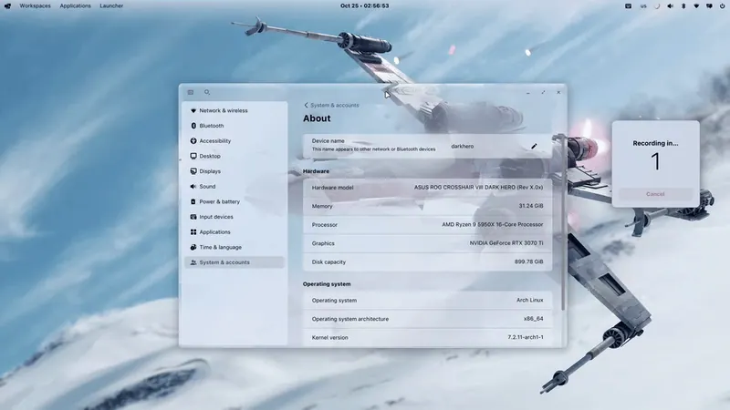
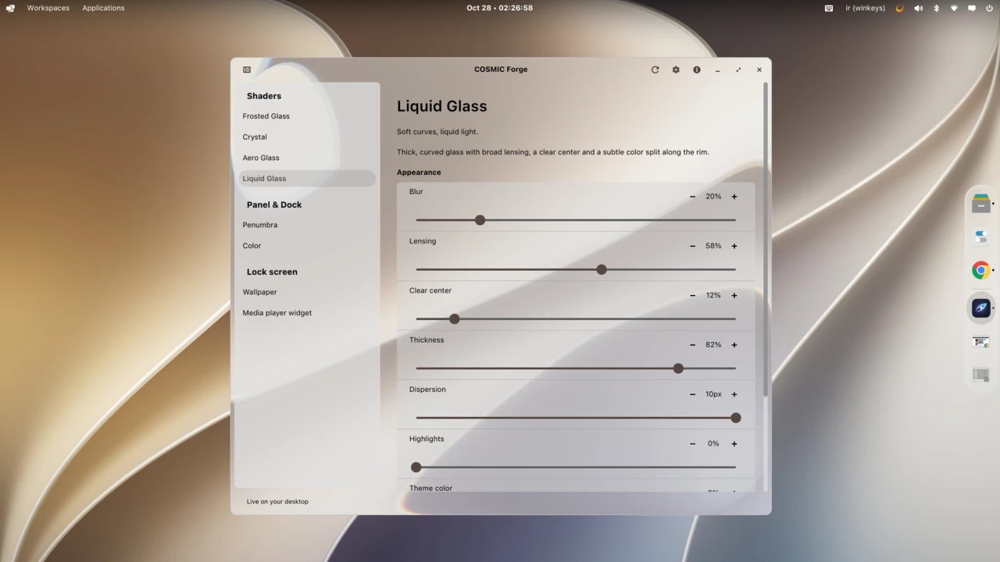
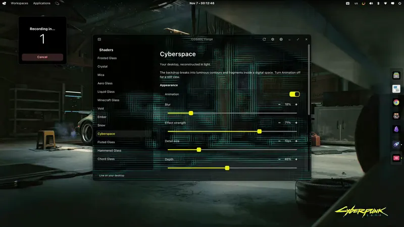
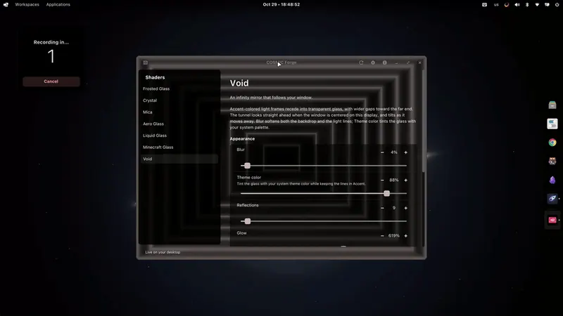
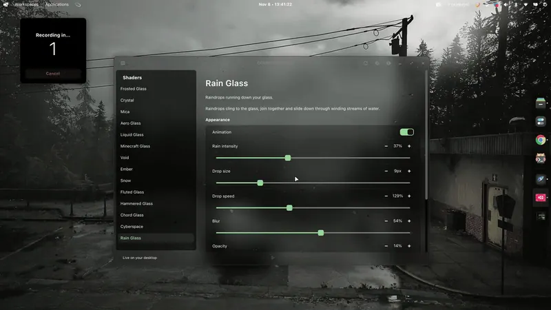
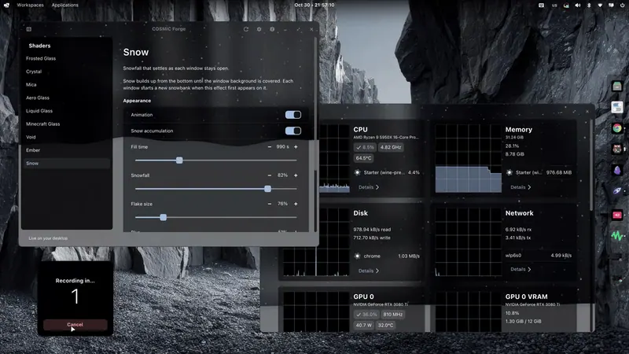
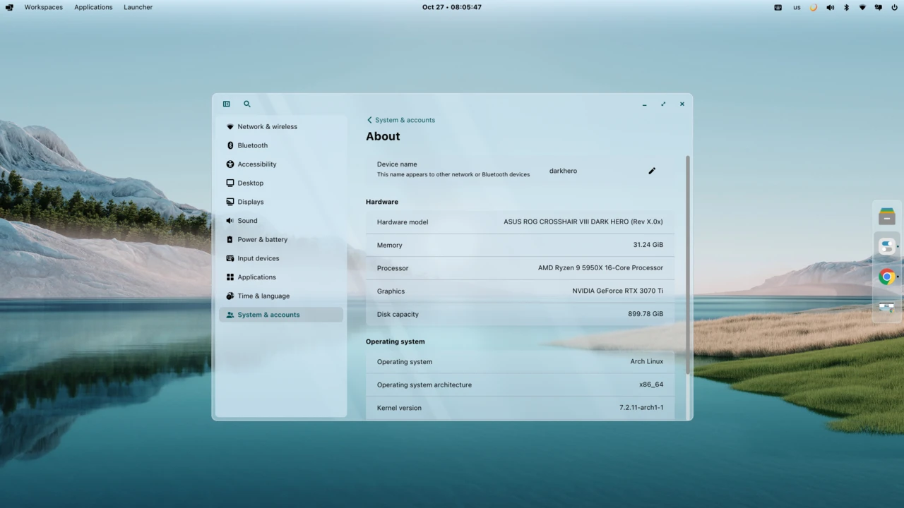
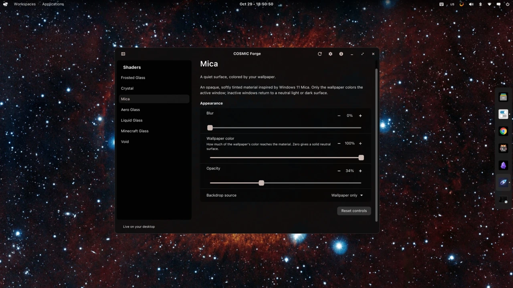
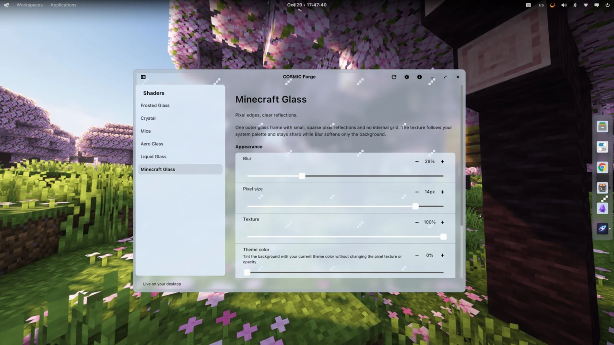
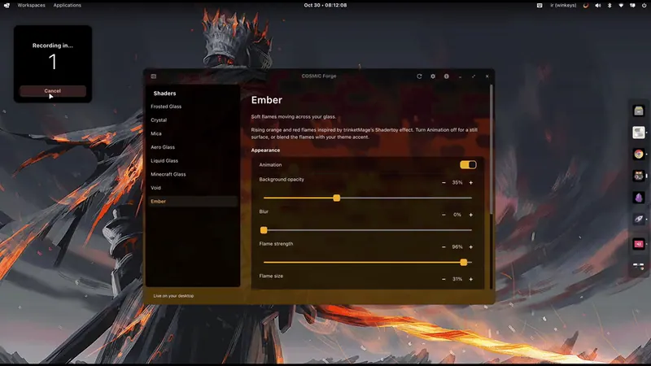

<p align="center"></p>
<h1 align="center">COSMIC Forge</h1>

Custom shaders for the **COSMIC desktop**. Apply and adjust effects,
or import your own JSON + `.frag` packs.

## Install

For Ubuntu/Pop!_OS, Fedora and Arch Linux. Requires COSMIC, Python 3.11+ and curl.

```sh
curl -fsSL https://raw.githubusercontent.com/motixo/cosmic-forge/main/install.sh | sh
```

Install the compositor from **Settings → Patches**, then log out and back in.

[Native packages](https://github.com/motixo/cosmic-forge/releases/latest) · [Create and import shaders](docs/adding-effects.md)

## Shader gallery

<table>
  <tr>
    <td align="center"><br><strong>Crystal</strong></td>
    <td align="center"><br><strong>Liquid Glass</strong></td>
  </tr>
  <tr>
    <td align="center"><br><strong>Cyberspace</strong></td>
    <td align="center"><br><strong>Void</strong></td>
  </tr>
  <tr>
    <td align="center"><br><strong>Rain Glass</strong></td>
    <td align="center"><br><strong>Snow</strong></td>
  </tr>
  <tr>
    <td align="center"><br><strong>Aero Glass</strong></td>
    <td align="center"><br><strong>Mica</strong></td>
  </tr>
  <tr>
    <td align="center"><br><strong>Minecraft Glass</strong></td>
    <td align="center"><br><strong>Ember</strong></td>
  </tr>
</table>

## Update reminders

Enable **Settings → Updates → Automatic update reminders** to check the app,
engine and shaders whenever Forge opens and every hour while it stays open.

## Uninstall

```sh
curl -fsSL https://raw.githubusercontent.com/motixo/cosmic-forge/main/install.sh | sh -s -- --uninstall
```

GPL-3.0-only
